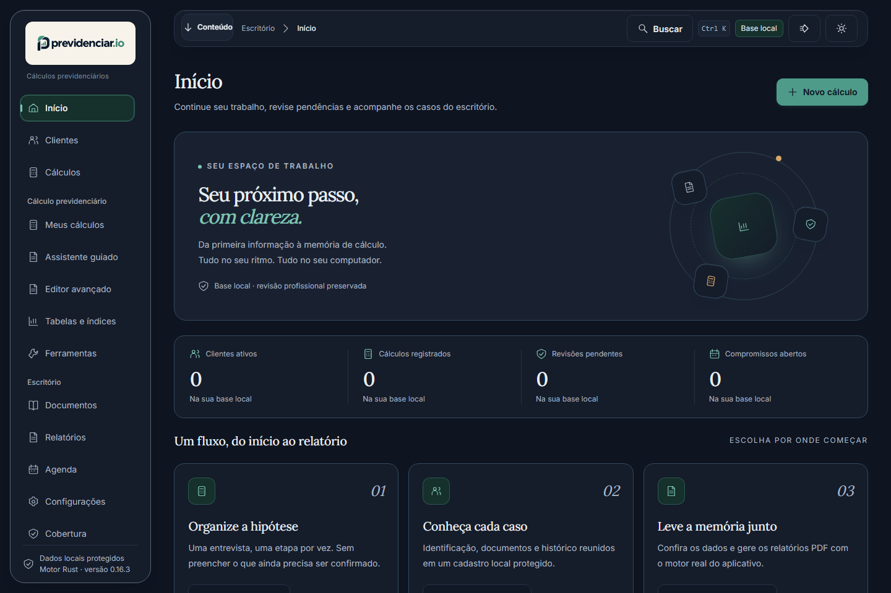

<p align="center">
  
</p>

<h1 align="center">Cálculos previdenciários, às claras.</h1>

<p align="center">
  <strong>CNIS, hipóteses, requisitos e PDF na sua máquina — com a memória do cálculo à vista.</strong>
</p>

<p align="center">
  <a href="https://github.com/ricarossetto/previdenciar.io/releases"></a>
  
  
  
  <a href="LICENSE"></a>
</p>

<p align="center">
  <a href="https://github.com/ricarossetto/previdenciar.io/releases"><strong>Baixar para Windows</strong></a>
  ·
  <a href="docs/GETTING_STARTED.md">Primeiros passos</a>
  ·
  <a href="docs/COVERAGE.md">O que o motor cobre</a>
  ·
  <a href="docs/LIMITATIONS.md">Limitações</a>
</p>

> **Ferramenta experimental, independente e de código aberto.** Não é serviço do INSS, não certifica direito a benefício e não substitui a revisão profissional. Hipótese bloqueada continua bloqueada; dado ausente não vira zero.

---

<table>
<tr>
<td width="33%" valign="top">

### O problema

Planilha por aqui, PDF por ali, uma regra que ninguém sabe de onde veio. No fim, o número aparece, mas a conta não.

</td>
<td width="33%" valign="top">

### A resposta

O app organiza o CNIS, mostra o que entrou no cálculo, quais requisitos foram cumpridos e o que ficou pendente — com fonte e memória.

</td>
<td width="33%" valign="top">

### O limite

O que o motor não sabe, ele **bloqueia com motivo**. Nada é aproximado por outra espécie, por outra regra ou por um valor inventado.

</td>
</tr>
</table>

## O que já está pronto

| Área | O que faz |
| --- | --- |
| **CNIS** | Lê o PDF com texto extraível: vínculos, remunerações, contribuições, cooperativa e valores consolidados por ano civil. |
| **Entrevista** | Sete etapas guiadas que guardam cada resposta e permitem voltar. A conferência abre com o que foi respondido. |
| **Motor RGPS** | 42, 41, 32, 31, **46 (especial)** e **57 (professor)**, com requisitos e bases publicados em [COVERAGE](docs/COVERAGE.md). |
| **PcD** | Cenário LC 142/2013 de grau constante, com premissas declaradas e índices públicos. |
| **Relatórios** | Oito PDFs gerados pelo renderer Rust, com prévia e exportação em lote sem sobrescrever arquivo. |
| **Qualidade** | Apuração por vínculo, com a regra e a fonte impressas no documento. |
| **Privacidade** | Base local cifrada no Windows. Importação, cálculo e PDF não saem da máquina. |

## Como o cálculo acontece

| | Etapa | O que você vê |
| :--: | --- | --- |
| 1 | **Identificação** | Nome do cálculo, cliente e módulo. |
| 2 | **CNIS** | Importação local e conferência por registro. |
| 3 | **Cenário** | Sexo, deficiência, espécie e DIB — sem inferência pelo nome. |
| 4 | **Vínculos** | Períodos editáveis, com a origem preservada. |
| 5 | **Salários** | Competências, valores e ajustes com justificativa. |
| 6 | **Parâmetros** | Correção, descarte, teto e as premissas da espécie. |
| 7 | **Revisão** | Confirmação explícita do que será calculado. |
| 8 | **Resultado** | RMI, requisitos, avisos, memória e PDF. |

<p align="center">
  
</p>
<p align="center"><sub>A base começa vazia: nenhum cliente, cálculo ou número é inventado para a tela ficar bonita.</sub></p>

## Espécies com motor próprio

| Espécie | Regra | Observação |
| --- | --- | --- |
| **42** | Tempo de contribuição | Regras de transição da EC 103 quando aplicáveis. |
| **41** | Idade | 65/60 anos por sexo. |
| **32 / 31** | Incapacidade permanente / temporária | A incapacidade é declarada; o motor calcula a renda. |
| **46** | Aposentadoria especial | PPP, agente e exposição **declarados**; requisito marcado como não verificado. |
| **57** | Professor | Magistério e exclusividade **declarados**. Direito adquirido do professor (80% × fator) não é calculado. |

Nenhuma espécie é aproximada por outra. As demais prestações bloqueiam com `especie_unsupported` e explicam o motivo.

## Baixar e instalar

1. Abra [Releases](https://github.com/ricarossetto/previdenciar.io/releases) e escolha a versão 0.16.3.
2. Baixe `previdenciar.io_0.16.3_x64-setup.exe` (recomendado) ou o portátil, junto com o `SHA256SUMS.txt`.
3. Confira o SHA-256 antes de executar. A distribuição não tem assinatura digital de código; o instalador é assinado apenas para o atualizador do próprio aplicativo.
4. Requer Windows 10/11 x64 com Microsoft Edge WebView2.
5. Use primeiro dados fictícios e leia os avisos. Não compartilhe CNIS, PDFs ou base em issues.

> O site publicado é apenas apresentação, documentação e download: não recebe documentos nem executa o motor.

## Privacidade

Importação, cálculo, PDFs e exportação acontecem na máquina do operador. A consulta opcional de índices e limites públicos envia apenas a competência pedida à Fábrica de Cálculos/TRF3, sem CNIS, identidade, salários ou dados de saúde. A chave da API é opcional, fica na base local cifrada e só é usada no botão de conferência de RMI, que envia somente datas, sexo, espécie e salários revisados.

Exportar com identificação oculta **não garante anonimização**: datas e valores ainda permitem correlação. Leia [privacidade](docs/PRIVACY.md).

## Compilar

Pré-requisitos: Rust estável, Microsoft C++ Build Tools, WebView2 e Node.js 24.

```powershell
cd apps/desktop
npm ci
npm run build
npm test

cd ..\..
cargo test --workspace --locked
cargo build --release --locked -p previus-next-desktop --bin previus-next-desktop
```

O binário sai em `target/release/previus-next-desktop.exe`. Os nomes internos dos crates e o identificador Tauri ficam por compatibilidade de armazenamento; a marca exibida é **previdenciar.io**.

Testes de navegador, dentro de `apps/desktop`:

```powershell
npx playwright install chromium
npm run test:e2e
```

<details>
<summary><strong>Testes: o que cada suíte cobre — e o que não cobre</strong></summary>

- **Rust**: parsing do CNIS, armazenamento, guardas, motor, PcD, PDFs e ponte tipada.
- **Interface**: fluxos com IPC sintético em memória.
- **Navegador (Playwright)**: navegação, acessibilidade e estados visuais.

Os testes de navegador **não** cobrem o transporte nativo do Tauri, o diálogo de exportação nem conformidade jurídica. Teste verde não é certificação de direito.

</details>

## Limites que não escondemos

- O motor não cobre todos os benefícios, regimes, datas históricas ou hipóteses especiais.
- Concomitâncias, PRPPS, CTC, datas abertas e moedas históricas exigem análise e confirmação.
- O livro de contribuições é um overlay documental; não altera o CNIS.
- PDF de imagem não tem OCR completo integrado.
- 46/57 não são enviados à conferência online da Fábrica.
- O direito adquirido do professor (80% × fator) não é calculado nesta versão.
- A distribuição é focada no Windows e não tem assinatura digital de código.
- Relatório é memória e revisão, não concessão, parecer ou reprodução certificada de outro software.

A lista completa, com a base de cada regra, está em [LIMITATIONS](docs/LIMITATIONS.md).

## Documentação

| Documento | Para quê |
| --- | --- |
| [Primeiros passos](docs/GETTING_STARTED.md) | Instalar, abrir e fazer o primeiro cálculo. |
| [Arquitetura](docs/ARCHITECTURE.md) | Contratos, camadas e por que o Rust é o motor. |
| [Cobertura](docs/COVERAGE.md) | Espécies, requisitos e bases legais. |
| [Limitações](docs/LIMITATIONS.md) | O que o app não faz — e por quê. |
| [Privacidade](docs/PRIVACY.md) | Onde os dados ficam e o que sai da máquina. |
| [Contribuições](docs/CONTRIBUTIONS.md) | Livro de revisão e rastreabilidade. |
| [LC 142](docs/LC142_SCENARIOS.md) | Cenário PcD com premissas declaradas. |
| [Build e release](docs/RELEASING.md) | Como gerar e publicar. |
| [Origem do código](docs/PROVENANCE.md) | Proveniência e atribuições. |

## Licença e independência

Código autoral sob [MIT](LICENSE). Projeto independente, sem vínculo oficial com o INSS nem com aplicações proprietárias usadas como referência de comportamento. Não distribuímos software proprietário, dumps, bases, documentos de clientes nem o histórico privado de desenvolvimento.

<p align="center"><sub>Feito para revisão profissional. O número só vale com a conta à vista.</sub></p>


