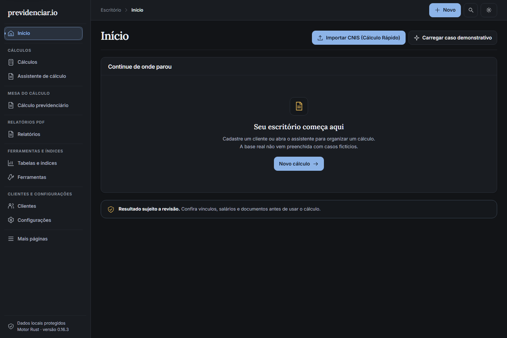

<p align="center">
  
</p>

> **Produto web oficial:** https://previdenciario.atrium.adv.br
>
> O desktop 0.16.x está congelado como legado. A evolução funcional ocorre no aplicativo web com login Cognito, PostgreSQL, S3 e backend Rust/Axum. Veja [produção AWS](docs/PRODUCTION_AWS.md) e [desktop congelado](docs/DESKTOP_FROZEN.md).

<h1 align="center">Cálculos previdenciários, às claras.</h1>

<p align="center">
  <strong>CNIS, hipóteses, requisitos e PDF na sua máquina — com a memória do cálculo à vista.</strong>
</p>

<p align="center">
  <a href="https://github.com/ricarossetto/previdenciar.io/releases"></a>
  
  
  
  <a href="LICENSE"></a>
</p>

<p align="center">
  <a href="https://github.com/ricarossetto/previdenciar.io/releases"><strong>Baixar para Windows</strong></a>
  ·
  <a href="docs/GETTING_STARTED.md">Primeiros passos</a>
  ·
  <a href="docs/COVERAGE.md">O que o motor cobre</a>
  ·
  <a href="docs/LIMITATIONS.md">Limitações</a>
</p>

> **Versão 0.16.3.** Ferramenta experimental, independente e de código aberto. Não é serviço do INSS, não certifica direito a benefício e não substitui a revisão profissional. Hipótese bloqueada continua bloqueada; dado ausente não vira zero.

---

<table>
<tr>
<td width="33%" valign="top">

### O problema

Planilha por aqui, PDF por ali, uma regra que ninguém sabe de onde veio. No fim, o número aparece, mas a conta não.

</td>
<td width="33%" valign="top">

### A resposta

O app organiza o CNIS, mostra o que entrou no cálculo, quais requisitos foram cumpridos e o que ficou pendente — com fonte e memória.

</td>
<td width="33%" valign="top">

### O limite

O que o motor não sabe, ele **bloqueia com motivo**. Nada é aproximado por outra espécie, por outra regra ou por um valor inventado.

</td>
</tr>
</table>

## O que já existe

- Cadastro local de clientes, cálculos, agenda e modelos de texto.
- Entrevista em sete etapas que organiza a hipótese, guarda cada resposta e permite voltar a qualquer ponto. A conferência abre com as respostas da entrevista e, logo abaixo, o preparo a partir do CNIS em um clique: a fonte não entra no motor, a cópia revisada entra, e a referência da conferência fica registrada. O quadro de rastreabilidade mostra o que veio do CNIS, o que foi ajustado e o que o motor usou.
- Importação de CNIS em PDF com texto extraível. Lê a tabela de vínculos, a de remunerações, a de contribuições (competência, data de pagamento, contribuição e salário), as linhas de cooperativa e a de valores consolidados por ano civil. A tabela que continua na página seguinte sem repetir o cabeçalho é lida com o contexto herdado.
- Editor de períodos e livro de contribuições rastreável. Alterar um dado invalida o resultado e a revisão anterior.
- Motor RGPS experimental com espécies 42 (tempo de contribuição), 41 (idade), 32 (incapacidade permanente), 31 (incapacidade temporária), 46 (especial) e 57 (professor), com requisitos, bases legais e limites próprios; nenhuma espécie é aproximada por outra.
- Conferência online opcional da RMI na Fábrica de Cálculos/TRF3, com chave própria e confirmação por envio: só datas, sexo, espécie e salários revisados; sem nome, CPF, NIT, CNIS ou PDF. O resultado do provedor fica ao lado do motor local, com fonte, horário e hash; o PDF detalhado imprime a conferência quando ela foi feita.
- Cenário PcD de grau constante pela LC 142/2013 com premissas declaradas. Consulta os índices e limites públicos da Fábrica de Cálculos/TRF3 e, quando a rede não responde, usa um snapshot local com as séries oficiais embutidas (INPC, IGP-DI e tetos), com a fonte declarada no arquivo.
- Oito relatórios PDF gerados pelo renderer Rust: completo, resumo, tempo de contribuição, remunerações, memória da RMI, regras de transição, pendências e indicadores, e cálculo da qualidade de segurado.
- Apuração da qualidade de segurado por vínculo, com a regra e a fonte impressas no documento: período de graça de 12 meses (art. 15, II, da Lei 8.213/1991), prorrogação para até 24 meses quando houve mais de 120 contribuições (art. 15, § 1º), carência de 180 contribuições (art. 25, II) ou a faixa da tabela do art. 142, contagem do contribuinte individual a partir do primeiro pagamento em dia (art. 27, II), tempo em gozo de benefício fora da carência (Decreto 3.048/1999, art. 19-C, § 1º) e competência contada uma única vez quando aparece em mais de um vínculo.
- Central de relatórios com título editável, opções de apresentação (anexo técnico, conferência de qualidade, premissas de planejamento) e exportação em lote para uma pasta, sem sobrescrever arquivo existente.
- Persistência local cifrada no Windows, gravação explícita e proteção contra sobrescrita depois de erro ou corrupção.
- Interface React/Tauri com temas claro e escuro, navegação móvel e opção de movimento reduzido.

## Espécies com motor próprio

| Espécie | Regra | Observação |
| --- | --- | --- |
| **42** | Tempo de contribuição | Regras de transição da EC 103 quando aplicáveis. |
| **41** | Idade | 65/60 anos por sexo. |
| **32 / 31** | Incapacidade permanente / temporária | A incapacidade é declarada; o motor calcula a renda. |
| **46** | Aposentadoria especial | PPP, agente e exposição **declarados**; requisito marcado como não verificado. |
| **57** | Professor | Magistério e exclusividade **declarados**. Direito adquirido do professor (80% × fator) não é calculado. |

Nenhuma espécie é aproximada por outra. As demais prestações bloqueiam com `especie_unsupported` e explicam o motivo.

<p align="center">
  
</p>
<p align="center"><sub>A base começa vazia: nenhum cliente, cálculo ou número é inventado para a tela ficar bonita.</sub></p>

## O que foi conferido

- 657 testes Rust (655 passaram, 2 ignorados), 248 testes de interface e 38 testes de navegador. A contagem é de 02/11/2026 e foi gerada por `node scripts/count-tests.mjs --run`, a fonte única desses números; a execução do cargo terminou sem falha.
- Verificação nativa em perfil isolado: importação, cálculo, as oito prévias de PDF, gravação cifrada e reabertura, sem tocar na base normal.
- Revisão de fonte pública: `node scripts/review-public-source.mjs` é a barreira que roda no CI antes de publicar. Ela bloqueia token, chave privada, ID de conta AWS, ARN, ID de pool e de client Cognito, identificadores de subnet, security group, instância EC2 e AMI, URL de túnel ou host interno, caminho pessoal e binário/arquivo privado. A varredura completa de 02/11/2026 passou sem achados. Restam duas exceções estreitas, declaradas no próprio script: o ID público do app client Cognito já publicado em `apps/desktop/src/auth-web.tsx` e o caminho do cache local do Cargo embutido em `web/engine.wasm`, liberado apenas quando o trecho é um diretório de crate de terceiro; `--strict` desliga as exceções.
- Um CNIS real de 23 páginas, conferido fora do repositório, passou a ser lido com 610 lançamentos e nenhuma diferença de salário por competência contra o relatório de um software de referência.
- Com o snapshot público da Fábrica de Cálculos, o mesmo caso chegou a R$ 5.161,10 contra R$ 5.200,89 do software de referência, uma diferença de 0,77%. Ela vem de sete competências que o CNIS lista apenas na visão "Contribuições" e que este programa mantém no período básico de cálculo. A escolha entre as duas leituras é profissional e está documentada.

## O que ainda não está pronto

O livro de contribuições está implementado: edição de competência e valor, moeda e vínculo declarados, filtros, ações em lote, consolidação por competência, exclusão documentada sem apagar o CNIS, histórico, desfazer e aplicação explícita aos salários do cálculo. A validação em Rust recusa origem, histórico ou projeção inconsistentes. Isso não valida regime, CTC ou direito a benefício. Consulte [o guia do editor](docs/CONTRIBUTIONS.md).

Não estão implementados: pensão por morte, salário-maternidade e auxílio-acidente; a carência legal por tabelas do RGPS anterior a 1991; a desconsideração por afastamento como o software de referência a faz (as fórmulas dele não são recuperáveis do binário, e nada foi inferido no lugar); e os módulos de planejamento (contribuição, frequência, alíquota, IRRF, retorno). O programa também não atualiza sozinho toda regra ou índice oficial, não cobre todos os regimes e benefícios, não é sistema de tramitação judicial e não tem backend web público. A conferência online da Fábrica está validada para as espécies 41 e 42. Nos testes sintéticos, 31 e 32 retornaram sem RMI no provedor com o payload atual; o app mantém o resultado local e mostra a resposta sem inventar valor. PcD (LC 142) não é enviada à conferência. Consulte [limitações](docs/LIMITATIONS.md) e [roadmap](docs/ROADMAP.md).

## Baixar e instalar

1. Abra [Releases](https://github.com/ricarossetto/previdenciar.io/releases) e escolha a versão 0.16.3.
2. Baixe o instalador `previdenciar.io_0.16.3_x64-setup.exe` (recomendado, cria atalhos e verifica atualizações) ou o executável portátil, junto com o `SHA256SUMS.txt`.
3. Confira o SHA-256 antes de executar. A distribuição não possui assinatura digital de código; o instalador é assinado apenas para o atualizador do próprio aplicativo.
4. Requer Windows 10/11 x64 com Microsoft Edge WebView2. Não desative proteções do Windows para ignorar alertas. Se não confiar no binário, compile a partir do código.
5. Use primeiro dados fictícios e leia os avisos. Não compartilhe CNIS, PDFs ou arquivos da base em issues.

> O site publicado é apenas apresentação, documentação e download: não recebe documentos nem executa o motor.

## Privacidade

Importação, cálculo, PDFs e exportação ocorrem na máquina do operador. Os fluxos implementados não enviam documentos a servidor nenhum. A consulta opcional de índices e limites públicos envia apenas a competência pedida à Fábrica de Cálculos/TRF3, sem CNIS, identidade, salários ou dados de saúde. A chave da API da Fábrica é opcional, fica na base local cifrada e só é usada no botão de conferência de RMI, que envia somente datas, sexo, espécie e salários revisados; nome, CPF, NIT, CNIS, PDF e anotações ficam fora. Sem a chave, o aplicativo usa apenas as rotas públicas e o motor local.

A base protegida do Windows fica no caminho legado de compatibilidade, sem migração silenciosa. Exportar com identificação oculta **não garante anonimização**, porque datas e valores ainda permitem correlação. A página no GitHub Pages é apenas apresentação, documentação e download: não recebe CNIS nem executa o motor Rust. Leia [privacidade](docs/PRIVACY.md).

## Compilar

Pré-requisitos: Rust estável, Microsoft C++ Build Tools, WebView2 e Node.js 24 com npm. O desktop desta distribuição tem foco no Windows.

```powershell
cd apps/desktop
npm ci
npm run build
npm test
cd ../..
cargo test --workspace --locked
cargo build --release --locked -p previdenciar-next-desktop --bin previdenciar-next-desktop
```

O binário é gerado em `target/release/previdenciar-next-desktop.exe`. Os crates, o pacote desktop e o identificador Tauri usam o nome `previdenciar`; a marca exibida é **previdenciar.io**.

Testes de navegador, dentro de `apps/desktop`:

```powershell
npx playwright install chromium
npm run test:e2e
```

Esses testes usam IPC sintético em memória e não cobrem o transporte nativo do Tauri, o diálogo de exportação ou a conformidade jurídica. A suíte Rust cobre separadamente o parsing, o armazenamento, as guardas, o cálculo e a geração dos PDFs sintéticos.

Para conferir a saúde da API publicada, dentro de `apps/desktop`:

```powershell
npm run check:health
```

O comando consulta `https://previdenciario.atrium.adv.br/api/health` e falha com código 1 quando a resposta não for JSON com `status: "ok"`. Aceita outra URL como argumento: `npm run check:health -- https://exemplo/api/health`. A regra de aprovação está em `scripts/health-core.mjs`, o mesmo módulo usado pelos testes da interface.

### Contagem de testes

A contagem publicada neste README vem de um único lugar: o script `scripts/count-tests.mjs`. Ele pergunta às próprias ferramentas quantos testes existem, em vez de manter números copiados em documentos.

```powershell
node scripts/count-tests.mjs              # tabela com Rust, vitest e Playwright
node scripts/count-tests.mjs --markdown   # bloco pronto para colar neste README
node scripts/count-tests.mjs --run        # executa a suíte Rust e conta ignorados
```

Funciona da raiz do repositório ou de `apps/desktop`. O `cargo test --list` compila o workspace e exige `apps/desktop/dist`; quando a pasta não existe, o script compila o frontend antes (use `--skip-build` para desligar). O `--list` conta os testes, mas não informa quantos são ignorados: isso só sai de uma execução real do `cargo test`, habilitada por `--run`. Os números em [O que foi conferido](#o-que-foi-conferido) são de 02/11/2026 e devem ser regerados com o script depois de qualquer mudança na suíte.

### Revisão de fonte pública

Antes de publicar, rode a barreira que impede segredo e identificador de infraestrutura de entrarem no repositório:

```powershell
node scripts/review-public-source.mjs             # varre os arquivos versionados
node scripts/review-public-source.mjs --self-test # autoverificação com fixtures sintéticas
node scripts/review-public-source.mjs --strict    # ignora a lista de exceções
```

Além de tokens e chaves privadas, ela bloqueia ID de conta AWS, ARN, ID de pool e de client Cognito, identificadores de subnet, security group, instância EC2 e AMI, e URL de túnel ou host interno. As exceções são estreitas: valem para o par exato de arquivo e valor, e o `--strict` as desliga antes da publicação.

## Documentação

| Documento | Para quê |
| --- | --- |
| [Primeiros passos](docs/GETTING_STARTED.md) | Instalar, abrir e fazer o primeiro cálculo. |
| [Arquitetura e contratos](docs/ARCHITECTURE.md) | Contratos, camadas e por que o Rust é o motor. |
| [Cobertura](docs/COVERAGE.md) | Espécies, requisitos e bases legais. |
| [Limitações](docs/LIMITATIONS.md) | O que o app não faz — e por quê. |
| [Privacidade](docs/PRIVACY.md) | Onde os dados ficam e o que sai da máquina. |
| [Editor de contribuições](docs/CONTRIBUTIONS.md) | Livro de revisão e rastreabilidade. |
| [Cenários PcD da LC 142](docs/LC142_SCENARIOS.md) | Cenário PcD com premissas declaradas. |
| [Roadmap](docs/ROADMAP.md) | Próximas etapas planejadas. |
| [Build, release e deploy](docs/RELEASING.md) | Como gerar e publicar. |
| [Origem do código](docs/PROVENANCE.md) e [atribuições](NOTICE.md) | Proveniência e atribuições. |
| [Prompt para logo e identidade](brand/DESIGN_PROMPT.md) | Direção visual do produto. |
| [Contribuir](CONTRIBUTING.md) · [segurança](SECURITY.md) | Como contribuir e reportar falhas. |

## Licença e independência

Código autoral sob [MIT](LICENSE). As licenças dos componentes e das fontes de terceiros continuam válidas. O uso é gratuito, sem assinatura exigida pelo aplicativo, e a licença MIT também permite uso comercial por terceiros, preservadas as condições.

Projeto independente, sem vínculo oficial com o INSS nem com aplicações proprietárias usadas como referência de comportamento. O nome não comprova registro de domínio ou de marca. Não distribuímos software proprietário, dumps, bases, documentos de clientes nem o histórico privado de desenvolvimento.

<p align="center"><sub>Feito para revisão profissional. O número só vale com a conta à vista.</sub></p>
